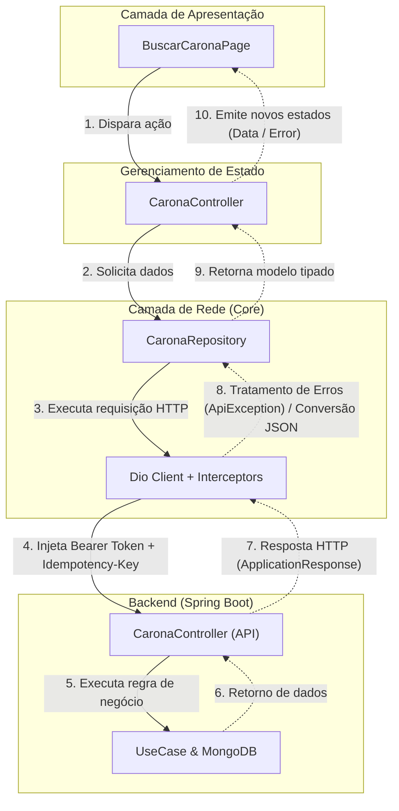

# Feature-Driven & Modular com Flutter

## 1. Visão Geral

Este documento descreve a arquitetura oficial do aplicativo móvel **Converge**, desenvolvido em **Flutter/Dart**. A arquitetura adota o padrão **Feature-Driven (Feature-First)** combinado a princípios de **Clean Architecture**, desenhada especificamente para manter simetria arquitetural direta com o backend do projeto (Monólito Modular Hexagonal com Spring Boot).

### Princípios Norteadores:

- **Simetria Arquitetural com o Backend:** Assim como o backend é dividido em `shared/` e `modules/`, o frontend é particionado em `core/` (recursos globais e transversais) e `features/` (módulos verticais de negócio).
- **Alta Coesão e Baixo Acoplamento:** Cada funcionalidade de negócio (carona, autenticação, usuário) encapsula sua própria camada de dados, regras de apresentação e componentes de interface.
- **Resiliência e Idempotência de Rede:** Estrutura de comunicação HTTP via interceptors que injetam chaves de idempotência (`Idempotency-Key`) em mutações críticas e realizam o tratamento uniforme do envelope de resposta da API (`ApplicationResponse`) mapeado para exceções de negócio tipadas (`ApiException` e `ApiErrorCode`).
- **Design System Centralizado e Monocromático:** Centralização estrita de paleta de cores, tipografia, temas e componentes visuais base em `core/config/styles.dart` (`AppColors`), `core/widgets/` e `core/theme/`. É terminantemente proibido o uso de cores hardcoded no aplicativo.
- **Previsibilidade de Estado:** Separação estrita entre a camada de apresentação pura (Widgets/Pages) e os controladores de estado/regras de tela (Riverpod / Notifiers / Cubits).

---

## 2. Estrutura Geral de Diretórios (`lib/`)

A base de código da aplicação reside em `app/converge/lib` e é organizada da seguinte forma:

```text
lib/
├── core/                           # Recursos globais e transversais (compartilhados)
│   ├── config/                     # Configurações de ambiente (app_config.dart) e Design Tokens (styles.dart / AppColors)
│   ├── network/                    # Cliente HTTP (Dio), interceptors (Auth, Idempotency, Error), ApiException e ApiResponse
│   ├── services/                   # Integrações externas e nativas (Firebase Auth, Maps, Geolocation, Storage)
│   ├── theme/                      # Configurações de ThemeData Material 3
│   ├── utils/                      # Formatadores (telefone, moeda, data) e validadores (Validators)
│   └── widgets/                    # Componentes visuais globais (RideDockNavigation, AppButton, AppTextField, etc.)
│
├── features/                       # Módulos verticais de negócio (Bounded Contexts)
│   ├── auth/                       # Autenticação, Onboarding, Login, Registro, Recuperação de Senha
│   │   ├── data/                   # Comunicação e Modelagem
│   │   │   ├── models/             # DTOs/Modelos de dados
│   │   │   └── repository/         # Chamadas de autenticação e sessão (AuthRepository)
│   │   ├── state/                  # Gerenciamento de estado (AuthController, AuthActionController)
│   │   └── presentation/           # Telas (LoginPage, RegisterPage, HomePage) e componentes locais
│   │
│   ├── carona/                     # Funcionalidade central de Caronas
│   │   ├── data/                   # Modelos e repositórios de dados (CaronaModel, CaronaRepository)
│   │   ├── state/                  # Gerenciamento de estado e regras de tela (CaronaController)
│   │   └── presentation/           # Interface visual (BuscarCaronaPage, DetalhesCaronaPage, widgets)
│   │
│   └── usuario/                    # Perfil, Avaliações e Vínculo Acadêmico
│       ├── data/
│       ├── state/
│       └── presentation/
│
├── app_routes.dart                 # Declaração centralizada de rotas e paths de navegação (GoRouter)
├── app_widget.dart                 # Configuração do MaterialApp, temas, rotas e providers globais
└── main.dart                       # Ponto de entrada (Bootstrap, Inicialização de serviços, Injeção)
```

---

## 3. Detalhamento do Núcleo Transversal (`core/`)

O diretório `core/` fornece serviços essenciais compartilhados por todas as features. Nenhuma classe de `core/` deve depender diretamente de classes localizadas em `features/`.

### 3.1. Configurações e Cores Centrais (`core/config/`)

Centraliza constantes de ambiente e tokens de cores da aplicação:

#### `AppConfig` (`core/config/app_config.dart`):
```dart
abstract class AppConfig {
  static const String appName = 'Converge';
  static const String apiBaseUrl = String.fromEnvironment(
    'API_BASE_URL',
    defaultValue: 'http://localhost:8080/api/v1',
  );
  static const Duration connectTimeout = Duration(seconds: 10);
  static const Duration receiveTimeout = Duration(seconds: 15);
}
```

#### `AppColors` (`core/config/styles.dart`):
Todo o app segue uma paleta monocromática elegante com cores semânticas bem definidas para feedback (erro e sucesso). **Todas as cores devem vir exclusivamente desta classe**:

```dart
abstract final class AppColors {
  // Primárias e Superfícies Escuras
  static const Color primary = Color(0xFF111111);
  static const Color primaryDark = Color(0xFF14171A);
  static const Color dockBackground = Color(0xFF111111);
  static const Color carButtonResting = Color(0xFF14171A);
  static const Color carButtonDepressed = Color(0xFF1E232A);

  // Fundos e Superfícies Claras
  static const Color scaffoldBackground = Color(0xFFF8FAFC);
  static const Color cardBackground = Color(0xFFFFFFFF);
  static const Color cardSecondary = Color(0xFFF8FAFC);
  static const Color neutralLight = Color(0xFFF1F5F9);
  static const Color inputBackground = Color(0xFFF8FAFC);
  static const Color buttonSecondary = Color(0xFFF3F4F6);
  static const Color chipBackground = Color(0xFFF5F5F5);

  // Bordas e Divisores
  static const Color borderSubtle = Color(0xFFE2E8F0);
  static const Color borderCardPressed = Color(0xFF111111);
  static const Color borderMedium = Color(0xFFCCCCCC);
  static const Color borderLight = Color(0xFFE5E5E5);
  static const Color footerBorder = Color(0xFFF2F2F2);
  static const Color chipBorder = Color(0xFFE0E0E0);
  static const Color routeLine = Color(0xFFCBD5E1);
  static const Color progressTrack = Color(0xFFEEEEEE);

  // Tipografia e Ícones
  static const Color textPrimary = Color(0xFF111111);
  static const Color textDark = Color(0xFF444444);
  static const Color textMedium = Color(0xFF666666);
  static const Color textSecondary = Color(0xFF64748B);
  static const Color textBodySecondary = Color(0xFF6B7280);
  static const Color textMuted = Color(0xFF94A3B8);
  static const Color textPlaceholder = Color(0xFF999999);
  static const Color textLight = Colors.white;
  static const Color iconMuted = Color(0xFF9CA3AF);

  // Estados e Feedback (Erro & Sucesso)
  static const Color error = Color(0xFFDC2626);
  static const Color errorBackground = Color(0xFFFEF2F2);
  static const Color errorBorder = Color(0xFFFECACA);
  static const Color errorText = Color(0xFFB91C1C);

  static const Color success = Color(0xFF15803D);
  static const Color successBackground = Color(0xFFF0FDF4);
  static const Color successBorder = Color(0xFFBBF7D0);

  // Itens de Navegação (Dock)
  static const Color dockItemActive = Colors.white;
  static const Color dockItemInactive = Color(0x70FFFFFF);
  static const Color dockIndicatorDot = Colors.white;

  // Barreira Translúcida
  static final Color barrier = Colors.black.withValues(alpha: 0.28);
}
```

---

### 3.2. Camada de Rede, Envelope de Resposta e Tratamento de Erros (`core/network/`)

A comunicação com o backend é orquestrada via `Dio`. A camada de rede incorpora três interceptores essenciais e um modelo padronizado de resposta e erros.

#### 1. Injeção de Autenticação (`AuthInterceptor`)
Injeta automaticamente o token Bearer no cabeçalho `Authorization: Bearer <token>` e renova sessões quando necessário.

#### 2. Idempotência em Operações de Mutação (`IdempotencyInterceptor`)
Gera e injeta uma chave única `Idempotency-Key` (UUID v4) para métodos `POST`, `PUT` e `PATCH`.

#### 3. Envelope da API e Tratamento de Exceções (`ApplicationResponse` & `ApiException`)

O backend do Converge responde requisições com o envelope padronizado:
```json
{
  "success": true,
  "data": { ... },
  "error": null,
  "timestamp": "2026-10-20T18:00:00Z"
}
```

Em cenários de falha, o envelope retorna `success: false` acompanhado dos detalhes do erro:
```json
{
  "success": false,
  "data": null,
  "error": {
    "code": "EMAIL_ALREADY_EXISTS",
    "message": "Este e-mail institucional já está cadastrado.",
    "fields": ["email"]
  },
  "timestamp": "2026-10-20T18:00:00Z"
}
```

##### Enum de Códigos de Erro (`core/network/api_error_code.dart`):
```dart
enum ApiErrorCode {
  badRequest('BAD_REQUEST'),
  userNotFound('USER_NOT_FOUND'),
  emailAlreadyExists('EMAIL_ALREADY_EXISTS'),
  invalidCredentials('INVALID_CREDENTIALS'),
  notAllowed('NOT_ALLOWED'),
  network('NETWORK'),
  unknown('UNKNOWN');

  final String value;
  const ApiErrorCode(this.value);

  static ApiErrorCode fromValue(Object? value) =>
      values.firstWhere((code) => code.value == value, orElse: () => unknown);
}
```

##### Classe de Exceção da API (`core/network/api_exception.dart`):
```dart
class ApiException implements Exception {
  final ApiErrorCode code;
  final String message;
  final Set<String> fields;
  final int status;

  const ApiException({
    required this.code,
    required this.message,
    required this.status,
    this.fields = const {},
  });

  bool get isNetworkError => code == ApiErrorCode.network;
  bool get isNotFound => status == 404;
  bool get isConflict => status == 409;
  bool get isUnauthorized => status == 401;

  factory ApiException.network() => const ApiException(
    code: ApiErrorCode.network,
    message: 'Não foi possível conectar ao servidor. Verifique sua internet.',
    status: 0,
  );

  factory ApiException.fromResponse(Object? body, {required int status}) {
    final error = body is Map<String, dynamic> ? body['error'] : null;
    if (error is! Map<String, dynamic>) return ApiException.fromStatus(status);

    final fields = error['fields'];
    return ApiException(
      code: ApiErrorCode.fromValue(error['code']),
      message: error['message'] as String? ?? _defaultMessage(status),
      status: status,
      fields: fields is List ? fields.map((f) => f.toString()).toSet() : const {},
    );
  }

  factory ApiException.fromStatus(int status) => ApiException(
    code: ApiErrorCode.unknown,
    message: _defaultMessage(status),
    status: status,
  );
}
```

##### Desempacotamento de Respostas (`core/network/api_response.dart`):
A função `unwrapApiResponse` extrai com segurança o campo `data` ou dispara a `ApiException` apropriada:
```dart
T unwrapApiResponse<T>(
  Object? body,
  T Function(Map<String, dynamic> json) fromJson, {
  int status = 200,
}) {
  if (body is! Map<String, dynamic> || body['success'] is! bool) {
    throw ApiException.fromStatus(500);
  }
  if (body['success'] != true) {
    throw ApiException.fromResponse(body, status: status);
  }
  final data = body['data'];
  if (data is! Map<String, dynamic>) throw ApiException.fromStatus(500);
  return fromJson(data);
}
```

##### Interceptor Global de Erros (`core/network/interceptors/error_interceptor.dart`):
Converte qualquer falha HTTP do `Dio` em uma `ApiException` acessível em `DioException.error`:
```dart
class ErrorInterceptor extends Interceptor {
  @override
  void onError(DioException err, ErrorInterceptorHandler handler) {
    handler.next(err.copyWith(error: _toApiException(err)));
  }

  ApiException _toApiException(DioException err) {
    final existing = err.error;
    if (existing is ApiException) return existing;

    final response = err.response;
    if (response == null) return ApiException.network();

    return ApiException.fromResponse(
      response.data,
      status: response.statusCode ?? 500,
    );
  }
}
```

##### Exceções de Autenticação (`core/services/auth/auth_exception.dart`):
Para erros de login social e Firebase Auth, utiliza-se a `AuthException`. No controlador de estado, a função `authErrorMessage` resolve qualquer exceção para uma mensagem amigável:
```dart
String authErrorMessage(Object error) => switch (error) {
  AuthException(:final message) => message,
  ApiException(:final message) => message,
  _ => 'Ocorreu um erro inesperado. Tente novamente.',
};
```

---

### 3.3. Serviços Externos (`core/services/`)

Encapsula dependências nativas e de terceiros sob contratos desacoplados:
- `AuthService`: abstrai login social, Firebase Auth e verificação de tokens.
- `LocationService`: abstrai GPS e cálculo de trajetos.
- `StorageService`: armazenamento seguro de tokens e credenciais locais.

### 3.4. Componentes Globais (`core/widgets/`)

- `RideDockNavigation`: barra de navegação inferior flutuante customizada (Floating Elevation Dock) com micro-interações fluidas e popover de ações contextuais de carona.
- `AppButton`: botões primários e secundários padronizados com suporte nativo a estado de loading.
- `AppTextField`: inputs de formulário com estados de foco, erro e formatação visual uniforme.

---

## 4. Estrutura de uma Feature (`features/{nomeFeature}/`)

Cada pasta dentro de `features/` representa um domínio isolado do aplicativo:

```text
features/carona/
├── data/
│   ├── models/
│   │   ├── carona_model.dart             # Model/DTO com fromJson e toJson
│   │   └── criar_carona_request.dart     # Payload de envio
│   └── repository/
│       ├── carona_repository.dart        # Interface abstrata do repositório
│       └── carona_repository_impl.dart   # Implementação concreta via Dio e unwrapApiResponse
│
├── state/
│   ├── carona_controller.dart            # Gerenciador de estado (AsyncNotifier / Notifier)
│   └── carona_state.dart                 # Estados da tela (Initial, Loading, Loaded, Error)
│
└── presentation/
    ├── pages/
    │   ├── buscar_carona_page.dart       # Página de busca e listagem
    │   ├── criar_carona_page.dart        # Formulário para motoristas
    │   └── detalhes_carona_page.dart     # Informações completas da viagem
    └── widgets/
        ├── card_carona.dart              # Card com horário, vagas e valor
        └── filtro_carona_sheet.dart      # Bottom sheet com filtros de pesquisa
```

### 4.1. Camada de Dados (`features/{feature}/data/`)

#### Repositório (`data/repository/carona_repository.dart`)
```dart
abstract class CaronaRepository {
  Future<List<CaronaModel>> listarCaronasDisponiveis();
  Future<CaronaModel> criarCarona(Map<String, dynamic> payload);
  Future<void> reservarVaga(String caronaId);
}

class CaronaRepositoryImpl implements CaronaRepository {
  final Dio _dio;
  CaronaRepositoryImpl(this._dio);

  @override
  Future<List<CaronaModel>> listarCaronasDisponiveis() async {
    final response = await _dio.get('/caronas');
    return (response.data['data'] as List)
        .map((e) => CaronaModel.fromJson(e as Map<String, dynamic>))
        .toList();
  }

  @override
  Future<CaronaModel> criarCarona(Map<String, dynamic> payload) async {
    final response = await _dio.post('/caronas', data: payload);
    return unwrapApiResponse(response.data, CaronaModel.fromJson);
  }

  @override
  Future<void> reservarVaga(String caronaId) async {
    await _dio.post('/caronas/$caronaId/reservar');
  }
}
```

### 4.2. Camada de Estado (`features/{feature}/state/`)

Responsável por orquestrar regras de negócio de tela e propagar erros via `ApiException`:

```dart
class CaronaController extends StateNotifier<AsyncValue<List<CaronaModel>>> {
  final CaronaRepository _repository;

  CaronaController(this._repository) : super(const AsyncValue.loading()) {
    carregarCaronas();
  }

  Future<void> carregarCaronas() async {
    state = const AsyncValue.loading();
    try {
      final caronas = await _repository.listarCaronasDisponiveis();
      state = AsyncValue.data(caronas);
    } on ApiException catch (e, st) {
      state = AsyncValue.error(e.message, st);
    } catch (e, st) {
      state = AsyncValue.error('Não foi possível carregar as caronas.', st);
    }
  }
}
```

---

## 5. Fluxo de Dados e Ciclo de Execução



---

## 6. Checklist para Criação de uma Nova Feature

Ao desenvolver uma nova funcionalidade no aplicativo Converge:

1. **Criar a pasta da feature** em `lib/features/{novaFeature}/`.
2. **Organizar em 3 subcamadas**:
   - `data/` (models, DTOs e repositório).
   - `state/` (controllers e provedores de estado).
   - `presentation/` (`pages/` navegáveis e `widgets/` locais).
3. **Mapear a API**:
   - Utilizar `unwrapApiResponse` e propagar exceções tipadas através de `ApiException`.
4. **Respeitar o Design System**:
   - **SEMPRE** utilizar `AppColors` de `core/config/styles.dart`. Cores hardcoded são proibidas.
   - Utilizar estritamente ícones nativos `Icons.*_rounded`.
   - Preservar assets essenciais (ex.: `assets/icon.png`).
5. **Cadastrar rotas no `app_routes.dart`** com GoRouter.
